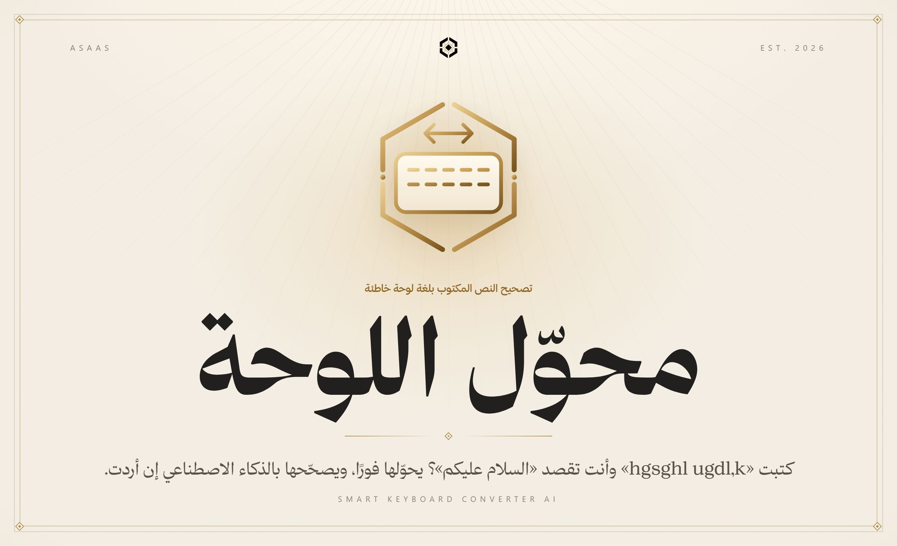
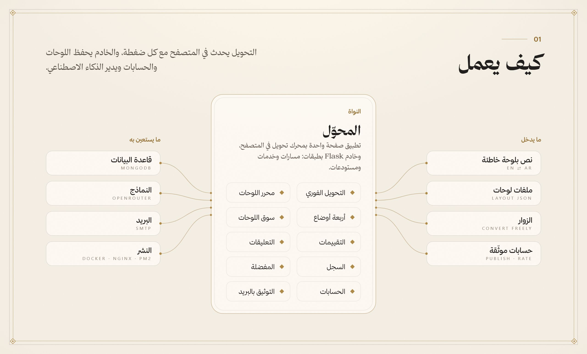
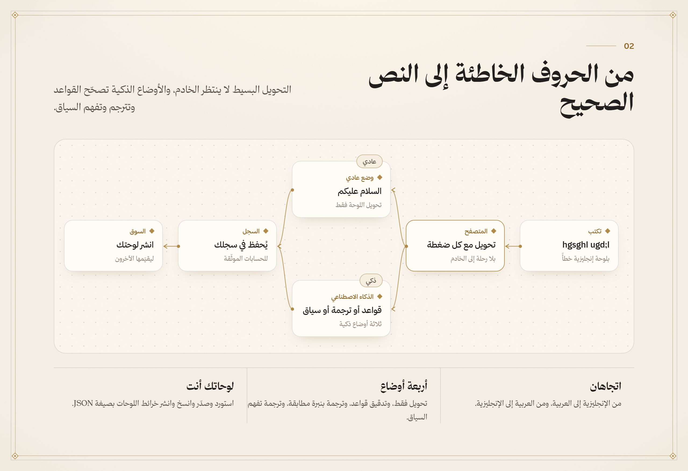
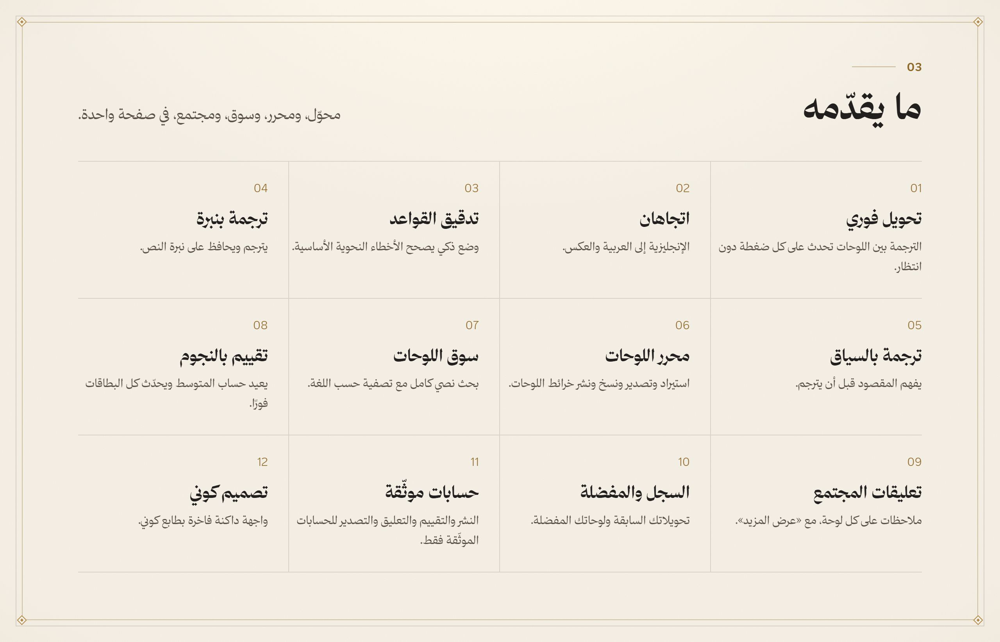
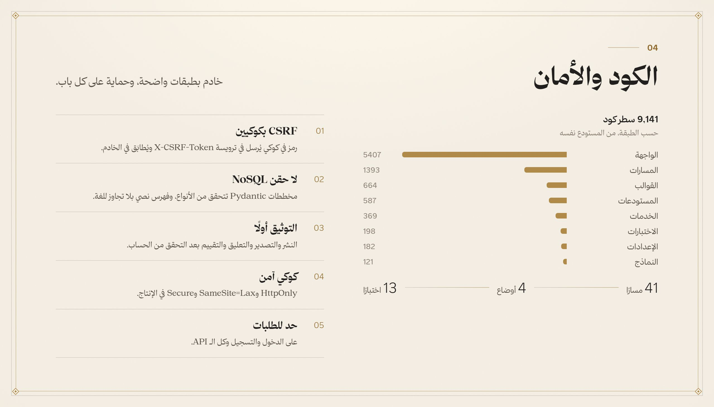
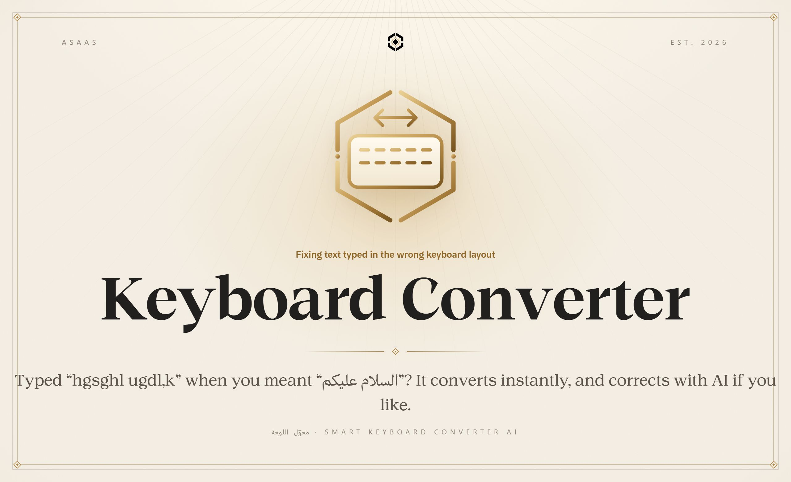
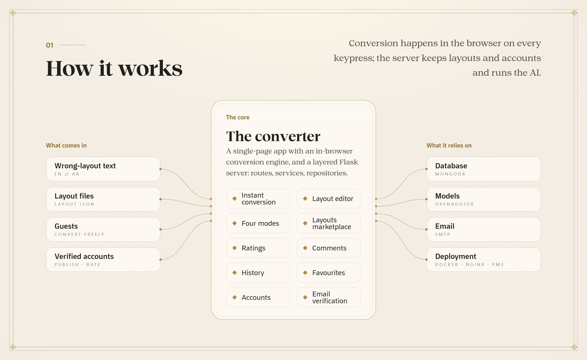
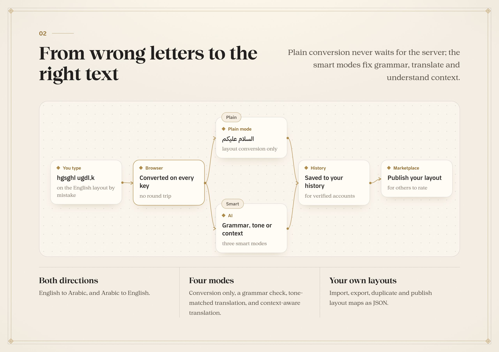
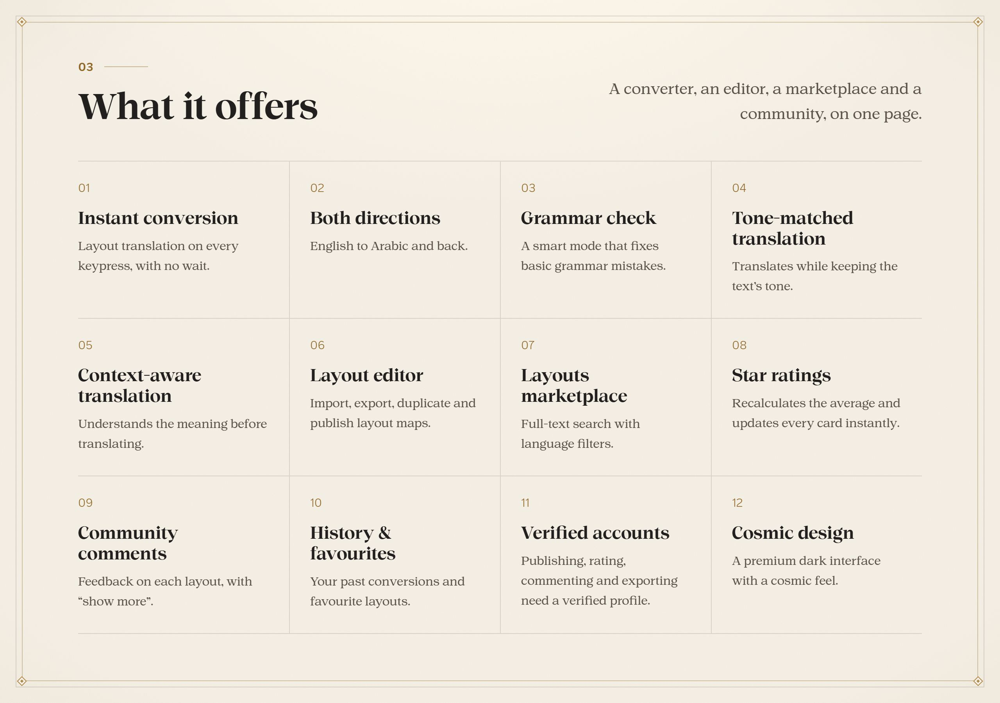
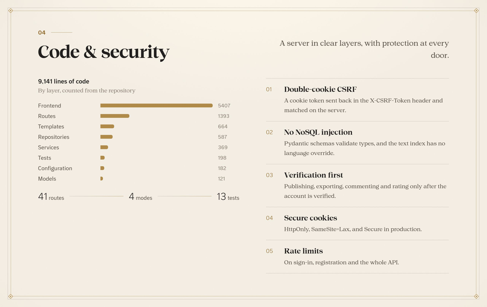

<a name="arabic"></a>

<p align="center"><b>العربية</b> · <a href="#english">English</a></p>



<br>

<div dir="rtl">

تطبيق صفحة واحدة يحوّل فورًا النص المكتوب بلغة لوحة خاطئة، من الإنجليزية إلى العربية وبالعكس، مع كل ضغطة ودون انتظار الخادم. وفوقه ثلاثة أوضاع بالذكاء الاصطناعي للتدقيق والترجمة، ومحرر لخرائط اللوحات، وسوق ينشر فيه المستخدمون لوحاتهم ويقيّمونها ويعلّقون عليها.

</div>

<br>









<br>

<div dir="rtl">

## التشغيل

```bash
pip install -r requirements.txt
python app.py
```

أو بالحاويات: `docker compose up -d`. الدليل الكامل بالإنجليزية في [`docs/GUIDE.md`](docs/GUIDE.md): خريطة المستودع، والأمان، والتثبيت، وDocker، وPM2، وNginx.

</div>

<p align="center"></p>

<a name="english"></a>

<p align="center"><a href="#arabic">العربية</a> · <b>English</b></p>



<br>

A single-page app that instantly converts text typed in the wrong keyboard layout, English to Arabic and back, on every keypress without waiting for the server. On top: three AI modes for checking and translating, a layout map editor, and a marketplace where people publish, rate and comment on layouts.

<br>









<br>

## Running it

```bash
pip install -r requirements.txt
python app.py
```

Or with containers: `docker compose up -d`. The full guide is in [`docs/GUIDE.md`](docs/GUIDE.md): repository map, security, setup, Docker, PM2 and Nginx.

<p align="center"></p>

<p align="center"></p>

<p align="center">
  <sub>جزء من منظومة <b>أساس</b> · Part of the <b>Asaas</b> ecosystem</sub>
  <br>
  <sub>من تصميم وبناء <a href="https://github.com/AladdinAlynaey">علاء الدين اليناعي</a> · Designed and built by <a href="https://github.com/AladdinAlynaey">Alaadin Alynaey</a></sub>
  <br>
  <sub>© 2026 · جميع الحقوق محفوظة · All rights reserved</sub>
</p>
